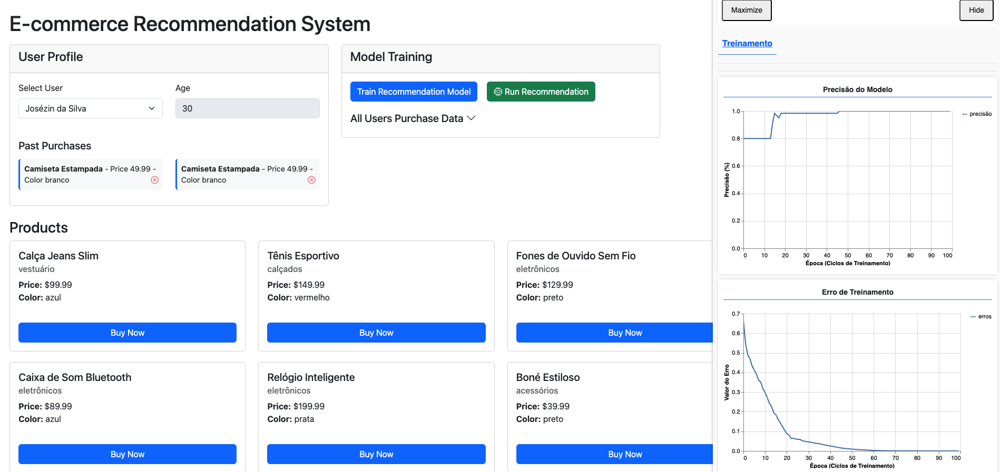

# E-commerce Recommendation System (Deep Learning with TensorFlow.js)

A browser app that trains a small neural network on users' purchase history and uses it to rank a product catalog for each user. It runs entirely in the browser: no backend, no Python.

This was the deep learning class of Module 1. The main point: **with a small dataset and good feature engineering, you can train a model that recommends products**.



## Running

```bash
npm install
npm start
```

Open `http://localhost:3000`. Then:

1. Pick a user and, if you like, buy a few products to change their history.
2. Click **Train Model**. The tfjs-vis panel shows loss and accuracy for each epoch.
3. Click **Run Recommendation** to see the catalog ranked for the selected user.

## How it works

All the ML code lives in [`src/workers/modelTrainingWorker.js`](./src/workers/modelTrainingWorker.js). It runs in a **Web Worker**, so training doesn't freeze the UI. The rest of the app (`controller/`, `view/`, `service/`) is plain MVC that sends messages to the worker and displays the results.

```
users.json + products.json
        │
        ▼
 makeContext()          min/max, one-hot indexes, avg buyer age per product
        │
        ▼
 encodeProduct()        product → numeric vector
 encodeUser()           user → average of their purchases' vectors
        │
        ▼
 createTrainingData()   every (user, product) pair → label 1 if bought, 0 if not
        │
        ▼
 configureNeuralNetAndTrain()   128 → 64 → 32 → 1 (sigmoid)
        │
        ▼
 recommend()            score every product for a user, sort descending
```

### 1. Turning data into numbers

A neural network only understands numbers. "Black", "accessories" and "R$ 159,99" have to become vectors first. That's what most of the code does, and it's where most of the learning happened.

**Normalization (min-max).** Price and age are squeezed into the 0–1 range with `(value - min) / (max - min)`. Without it, price (hundreds) would outweigh age (tens) just because of its scale.

**One-hot encoding.** Category and color have no natural order, so each one becomes a vector with a single position "on":

```
categories = [eletrônicos, vestuário, calçados, acessórios]
acessórios → [0, 0, 0, 1]
```

Encoding them as `0, 1, 2, 3` instead would teach the network that "acessórios" is somehow *bigger* than "eletrônicos".

**Weights.** Each feature is multiplied by how much it should matter:

| Feature | Weight |
|---|---|
| category | 0.4 |
| color | 0.3 |
| price | 0.2 |
| age | 0.1 |

**Average buyer age per product.** Each product gets a "typical age", the mean age of the people who bought it. This links a user's age to products that people of that age buy. Products nobody bought get the middle age, a neutral value.

The final product vector has 14 numbers with this dataset (4 categories, 8 colors):

```
[price, avgBuyerAge, ...4 category one-hot, ...8 color one-hot]
```

### 2. Representing a user

A user becomes **the average of the vectors of what they bought**, in the same 14-number format as a product. If half their purchases are black and half are gray, the color part reads `0.15, 0.15` (0.5 × 0.3 each). The vector records their taste as proportions.

A user with no purchases (**cold start**) only has an age. Everything else is zero, so their recommendations are driven by age alone.

### 3. The training data

Every (user, product) pair becomes one training example:

```
input = [...userVector (14), ...productVector (14)]   → 28 numbers
label = 1 if the user bought that product, else 0
```

The network learns to answer one question: *"would this user buy this product?"*

With 5 users and 10 products, that's **50 examples, 12 of them positive**. It's tiny, which was the point of the class.

### 4. The network

| Layer | Units | Activation | Role |
|---|---|---|---|
| Input + dense | 128 | ReLU | Many "eyes" to detect combinations of features |
| Dense | 64 | ReLU | Starts compressing the information |
| Dense | 32 | ReLU | Keeps only the strongest patterns |
| Output | 1 | Sigmoid | A score from 0 to 1: how likely they are to buy |

- **ReLU** passes positive signals through and zeroes out negative ones. That's what lets the network learn non-linear patterns.
- **Sigmoid** squeezes the output into 0–1, so it reads as a probability.
- **Adam** (learning rate 0.01) is the optimizer that adjusts the weights after each batch.
- **Binary cross-entropy** is the loss function for yes/no problems. It punishes confident wrong answers hardest.
- **Training settings:** 100 epochs, batch size 32, shuffled every epoch.

### 5. Recommending

1. Encode the selected user into a vector.
2. Concatenate it with every precomputed product vector.
3. Run `model.predict()` on all the pairs in one batch.
4. Sort the products by score.

## What I learned

- **Feature engineering matters more than the network.** The network is about 15 lines. Most of the code, and most of the thinking, goes into turning real data into good numbers.
- **Normalization and one-hot encoding are not optional.** Skipping them silently teaches the model wrong things, like scale meaning importance or categories having an order.
- **A user can live in the same space as the products.** Averaging purchase vectors puts users and products in the same 14-dimensional space. That's also the idea behind embeddings and vector search.
- **Recommendation can be framed as binary classification.** "Score this (user, product) pair" turns a fuzzy problem into a standard yes/no one.
- **Heavy work belongs in a Web Worker.** Training on the main thread would lock up the page.
- **Small data still works for learning,** but it changes how you should read the metrics (see below).

## Notes and recommendations

These came up while reviewing the code after the class.

**Accuracy is misleading here.** Only 12 of the 50 examples are positive, so a model that always answers "won't buy" already scores 76%. Judge the model by the ranking it produces, or use precision/recall. Don't trust the accuracy curve on its own.

**Overfitting is almost guaranteed.** A 128-64-32 network has thousands of parameters for 50 examples, and it trains on all of them with no validation set. It will mostly memorize who bought what. That's fine for a demo. For anything real:
- hold out data with `validationSplit: 0.2` and watch `val_loss`;
- use a smaller network or add `dropout`;
- stop early when validation loss stops improving.

**Already-purchased products show up in the recommendations.** They were labeled 1 during training, so they usually rank highest. Filter them out in `recommend()` before sending the list:

```js
const bought = new Set(user.purchases.map(p => p.name))
const sortedItems = recommendations
    .filter(item => !bought.has(item.name))
    .sort((a, b) => b.score - a.score)
```

**Tensors are never disposed.** TensorFlow.js doesn't garbage-collect GPU memory. Every `encodeProduct`, `encodeUser` and `predict` call leaks a little. Wrap that work in `tf.tidy(() => ...)` or call `.dispose()` on the tensors.

**The model is lost on refresh.** Save it with `model.save('indexeddb://recommender')` and load it with `tf.loadLayersModel(...)`, so you don't retrain every time.

**Products are keyed by `name`.** The age averages and the labels look products up by name. Two products with the same name would collide, so `id` is the safer key.

**The context is frozen at training time.** Min/max values, colors and categories come from the training data. A new color or an out-of-range age at recommendation time produces bad vectors or values outside 0–1. Retrain whenever the catalog changes.

**Scaling up.** Scoring every product works for 10 products, not for 100k. The usual pattern:
1. Store the product vectors in a vector database (pgvector, Pinecone, etc.).
2. Fetch the ~200 nearest products to the user vector.
3. Run the model only on those candidates.

The feature weights pay off here, because they shape the distances in that first search.

**Dev server watch path.** `npm start` tells browser-sync to watch `js/*.js`, but the code is in `src/`. Change it to `src/**/*.js` so edits reload the page.

## Project structure

```
├── index.html               # UI + loads tfjs-vis
├── data/
│   ├── users.json           # 5 users, each with an age and purchases
│   └── products.json        # 10 products: category, color, price
└── src/
    ├── index.js             # Wires everything together
    ├── workers/
    │   └── modelTrainingWorker.js   # ⭐ All the ML: encoding, training, recommending
    ├── controller/          # Connects views, services and the worker
    ├── view/                # DOM rendering + tfjs-vis charts
    ├── service/             # User/product data (sessionStorage)
    └── events/              # Event names shared by the UI and the worker
```

## References

See [`refs.txt`](./refs.txt). The most useful for this class:

- [MLU Explain: Neural Networks](https://mlu-explain.github.io/neural-networks/), a visual explanation of how a network learns
- [Coding a deep learning model using TensorFlow.js (IBM)](https://developer.ibm.com/tutorials/coding-a-deep-learning-model-using-tensorflow-javascript/)
- [Vector Storage: a vector database for the browser](https://nitaiaharoni1.medium.com/introducing-vector-storage-a-lightweight-vector-database-for-the-browser-bc10775fd9dd), a next step for the scaling note above
